<div align="center">


# GoodGood

**Un administrador de tareas para Windows rápido, moderno y con información detallada**

[한국어](README.md) · [English](README.en.md) · **Español** · [Deutsch](README.de.md) · [日本語](README.ja.md) · [Français](README.fr.md) · [Русский](README.ru.md)

[](https://goodgoodtask.com/es/)

Explore la interfaz interactiva y el recorrido de funciones en el [sitio oficial](https://goodgoodtask.com/es/) desde el navegador, sin instalar la aplicación.

[](https://github.com/acc0mplish/GoodGood/releases)
[](https://github.com/acc0mplish/GoodGood/releases)
[](#system-requirements)
[](LICENSE)

[Funciones](#features) · [Descarga](#download) · [Compilar desde el código fuente](#build-from-source) · [Atajos de teclado](#keyboard-shortcuts) · [Documentación](#documentation)

</div>

<br>

<picture>
  <source media="(prefers-color-scheme: dark)" srcset="docs/images/screenshot-en-dark.png">
  
</picture>

<sub>Vista previa de la interfaz en inglés.</sub>

<br>

GoodGood consulta directamente las API nativas de Windows mediante Rust. Su interfaz utiliza componentes nativos de GPUI Kit y gráficos que se desplazan con fluidez a la frecuencia de actualización de la pantalla. El nombre procede de Argos Panoptes, el gigante de cien ojos de la mitología griega.

<a id="star-history"></a>

## ⭐ Historial de estrellas

Si GoodGood resulta útil en el trabajo diario, una estrella en GitHub es una forma directa de apoyar el proyecto y ayudar a que más personas lo descubran.

<a href="https://www.star-history.com/#acc0mplish/GoodGood&Date">
  <picture>
    <source media="(prefers-color-scheme: dark)" srcset="https://api.star-history.com/svg?repos=acc0mplish/GoodGood&type=Date&theme=dark">
    
  </picture>
</a>

<a id="features"></a>

## ✨ Funciones

<table>
<tr>
<td width="50%" valign="top"><picture><source media="(prefers-color-scheme: dark)" srcset="docs/images/features/processes-es-dark.svg"></picture><br><b>Procesos</b>: vistas por aplicación, árbol de procesos o lista; buscar, ordenar y finalizar árboles completos</td>
<td width="50%" valign="top"><picture><source media="(prefers-color-scheme: dark)" srcset="docs/images/features/performance-es-dark.svg"></picture><br><b>Rendimiento</b>: carga por núcleo, velocidad, temperatura y potencia de la CPU, además de memoria, discos, red y GPU</td>
</tr>
<tr>
<td width="50%" valign="top"><picture><source media="(prefers-color-scheme: dark)" srcset="docs/images/features/history-es-dark.svg"></picture><br><b>Historial</b>: al hacer clic en un momento de los gráficos de 7 días se muestran los procesos más ocupados</td>
<td width="50%" valign="top"><picture><source media="(prefers-color-scheme: dark)" srcset="docs/images/features/files-es-dark.svg"></picture><br><b>Archivos en uso</b>: al arrastrar un archivo o carpeta a la ventana se muestran los procesos que lo utilizan</td>
</tr>
<tr>
<td width="50%" valign="top"><picture><source media="(prefers-color-scheme: dark)" srcset="docs/images/features/rules-es-dark.svg"></picture><br><b>Menú contextual</b>: establecer la prioridad, activar el modo de eficiencia o añadir una regla para cada inicio</td>
<td width="50%" valign="top"><picture><source media="(prefers-color-scheme: dark)" srcset="docs/images/features/ports-es-dark.svg"></picture><br><b>Conexiones y puertos</b>: buscar conexiones y sus procesos por puerto, y cerrarlas</td>
</tr>
</table>

<table>
<tr>
<td width="50%" valign="top"><b>Servicios y aplicaciones de inicio</b><br>Iniciar y detener servicios, cambiar su tipo de inicio y activar o desactivar aplicaciones de inicio</td>
<td width="50%" valign="top"><b>Bandeja del sistema</b><br><kbd>Ctrl</kbd>+<kbd>Alt</kbd>+<kbd>Esc</kbd> muestra u oculta la ventana; consumo mínimo mientras está oculta</td>
</tr>
<tr>
<td width="50%" valign="top"><b>Sustitución del Administrador de tareas</b><br>Puede <a href="docs/architecture/task-manager.md">sustituir el Administrador de tareas de Windows</a> y abrirse con <kbd>Ctrl</kbd>+<kbd>Shift</kbd>+<kbd>Esc</kbd>; ejecuta tareas nuevas y reinicia el Explorador de Windows</td>
<td width="50%" valign="top"><b>Aspecto e idiomas</b><br>Fondo Mica, color de énfasis y tema claro u oscuro según Windows; 7 idiomas de interfaz</td>
</tr>
<tr>
<td width="50%" valign="top"><b>Actualizaciones integradas</b><br>Canales Estable y Beta, descarga en segundo plano y notas de la versión en la aplicación</td>
<td width="50%" valign="top"><b>Permisos</b><br>Todos los procesos son visibles con una cuenta estándar; el servicio privilegiado y el inicio como administrador son opcionales</td>
</tr>
</table>

<sub>Debido a las limitaciones de espacio y de formato de imagen de un README, las demostraciones anteriores son recreaciones simplificadas de la interfaz de GoodGood con procesos y datos de ejemplo. Son solo orientativas; la aplicación real es la referencia.</sub>

<a id="download"></a>

## 📦 Descarga

La [página oficial de descargas](https://goodgoodtask.com/es/download/) ofrece la última versión estable y sus sumas SHA-256. Todas las versiones están disponibles en [GitHub Releases](https://github.com/acc0mplish/GoodGood/releases).

| Archivo | Descripción |
|---|---|
| `GoodGood_<version>_x64-setup.exe` | **Instalador, recomendado.** Instala para todos los usuarios en `Program Files`. La instalación y las actualizaciones requieren autorización de administrador. Admite actualizaciones integradas. |
| `GoodGood_<version>_x64.exe` | **Versión portátil.** Ejecutable independiente que comparte la configuración y el historial con la versión instalada. No admite actualizaciones automáticas. |
| `SHA256SUMS.txt` | Sumas SHA-256 de los archivos de la versión. |

[Política de firma de código](#code-signing-policy) · [Política de privacidad (inglés)](PRIVACY.md#english)

<a id="system-requirements"></a>

## 💻 Requisitos del sistema

- **Sistema operativo**: Windows 10 22H2 —compilación 19045— o posterior, incluido Windows 11; arquitectura x64.
- **Gráficos**: dispositivo gráfico y controlador compatibles con DirectX 11.

Las versiones de Windows verificadas, las diferencias entre funciones y los permisos necesarios se detallan en la [guía de compatibilidad](docs/guide/hardware-data.md#시스템-호환-범위).

<a id="build-from-source"></a>

## 🔧 Compilar desde el código fuente

Requisitos:

- Cadena de herramientas Rust `stable-x86_64-pc-windows-msvc`, versión 1.100.0 o posterior.
- Node.js 26.x desde 26.13.1, o 24.x LTS desde 24.22.3, y bun 1.4.4.
- Visual Studio Build Tools con la carga de trabajo de desarrollo de escritorio con C++.

Ejecutar en PowerShell desde la raíz del repositorio:

```powershell
.\start.bat           # Desarrollo: recompila y reinicia al cambiar Rust o recursos; si falla, conserva la instancia actual
.\start.bat build     # Compilación de distribución: genera target\release\goodgood.exe
```

La [guía de desarrollo](docs/development/README.md) explica las comprobaciones de código, la creación del instalador y la limpieza de cachés.

<a id="keyboard-shortcuts"></a>

## 🔑 Atajos de teclado

| Acción | Teclas |
|---|---|
| Cambiar de página | <kbd>Ctrl</kbd>+<kbd>1</kbd> … <kbd>Ctrl</kbd>+<kbd>8</kbd> |
| Buscar procesos | <kbd>Ctrl</kbd>+<kbd>F</kbd> |
| Pausar temporalmente las actualizaciones | Mantener <kbd>Ctrl</kbd>; soltar para reanudar, en Procesos y Rendimiento |
| Abrir detalles | <kbd>Enter</kbd> |
| Finalizar tarea | <kbd>Alt</kbd>+<kbd>E</kbd> o <kbd>Delete</kbd>; <kbd>Shift</kbd>+<kbd>Delete</kbd> omite la confirmación |
| Mostrar u ocultar la ventana, global | <kbd>Ctrl</kbd>+<kbd>Alt</kbd>+<kbd>Esc</kbd> |

La lista completa está en **Configuración → Atajos de teclado → Ver atajos**. La [guía de uso](docs/guide/README.md) incluye más detalles.

<a id="documentation"></a>

## 📚 Documentación

Las guías detalladas están en coreano. La [documentación en línea](https://goodgoodtask.com/docs/) ofrece ediciones estable y de desarrollo.

| Documento | Contenido |
|---|---|
| [Guía de uso](docs/guide/README.md) | Interfaz y operaciones, bandeja y atajos, configuración, fuentes y límites de los datos de hardware |
| [Guía de desarrollo](docs/development/README.md) | Entorno y comandos, compilación y cachés, referencias y medición del rendimiento |
| [Arquitectura](docs/architecture/README.md) | Capas del sistema, flujo de datos, tecnologías y responsabilidades de los módulos |
| [Diseño](docs/design/README.md) | Principios de diseño, animación de gráficos, aspecto y materiales de las ventanas |
| [Problemas conocidos](docs/known-issues.md) | Limitaciones de la versión actual |
| [Registro de cambios](changelog/es-ES.md) | Cambios detallados de cada versión |

<a id="contributing"></a>

## 🤝 Contribuir

Se agradecen los informes de problemas y las solicitudes de cambios. Las vulnerabilidades deben comunicarse de forma privada mediante la página de avisos de seguridad.

<a id="roadmap"></a>

## 🧭 Hoja de ruta

La [hoja de ruta](docs/roadmap.md) recoge los hitos completados y el plan completo. Entre los trabajos actuales y previstos:

- [ ] **Más sensores de hardware**: ampliar la cobertura de hardware de consumo mediante el controlador oficial PawnIO; consultar el [hardware compatible](docs/guide/hardware-data.md).
- [ ] **Más combinaciones de teclas**: distinguir modificadores izquierdos y derechos, y admitir combinaciones compuestas solo por modificadores o por dos teclas normales.

<a id="code-signing-policy"></a>

## 🔐 Política de firma de código

El servicio gratuito de firma de código lo proporciona [SignPath.io](https://about.signpath.io/) y el certificado lo proporciona [SignPath Foundation](https://signpath.org/).

Free code signing provided by [SignPath.io](https://about.signpath.io/), certificate by [SignPath Foundation](https://signpath.org/).

La firma de prueba está integrada. Actualmente, las versiones oficiales se distribuyen sin firmas de Windows Authenticode. Cuando se active la firma de producción, abarcará la aplicación GoodGood, los auxiliares del Administrador de tareas, el desinstalador y el instalador compilados desde este repositorio mediante GitHub Actions. Los programas de terceros incluidos conservarán sus firmas originales.

- **Política de privacidad**: [English](PRIVACY.md#english) · [한국어](PRIVACY.md#한국어). Describe la búsqueda de actualizaciones activada de forma predeterminada, el uso alternativo de proxies, las descargas de PawnIO bajo demanda, los comentarios voluntarios y el tratamiento de datos por terceros.

Las actualizaciones integradas utilizan una clave de publicación Minisign independiente para verificar los instaladores y sus números de versión. Windows Authenticode identifica al firmante del ejecutable.

<a id="acknowledgements"></a>

## 🙏 Agradecimientos

GoodGood se basa en los siguientes proyectos de código abierto:

| Proyecto | Uso |
|---|---|
| [GPUI Kit](https://gpui-kit.com/) | Componentes nativos de escritorio, ventanas, tablas y gráficos |
| [windows-rs](https://github.com/microsoft/windows-rs) | Enlaces de Rust para las API nativas de Windows |
| [Biome](https://biomejs.dev/), [NSIS](https://nsis.sourceforge.io/) | Comprobaciones de desarrollo y empaquetado para Windows |
| [serde](https://serde.rs/), [reqwest](https://github.com/seanmonstar/reqwest) y otros crates de Rust | Serialización, solicitudes de red y funciones básicas |
| [PawnIO](https://pawnio.eu/), [PawnIO.Modules](https://github.com/namazso/PawnIO.Modules) | Controlador firmado y módulos de recopilación para los sensores opcionales del kernel |
| [ZenStates-Core](https://github.com/irusanov/ZenStates-Core), [LibreHardwareMonitor](https://github.com/LibreHardwareMonitor/LibreHardwareMonitor), [GNR-SMU](https://github.com/Kyworn/gnr-smu) | Referencias de la disposición de registros de CPU, como las tablas AMD SMU |
| [Intel IGCL](https://github.com/intel/drivers.gpu.control-library), [AMD ADL](https://github.com/GPUOpen-LibrariesAndSDKs/display-library) | Interfaces de telemetría de GPU |

La lista completa de componentes de terceros y sus avisos de licencia se encuentra en [THIRD-PARTY-NOTICES.txt](THIRD-PARTY-NOTICES.txt).

<!-- supporters:start · node scripts/supporters.mjs -->
<!-- supporters:end -->

<a id="license"></a>

## 📄 Licencia

GoodGood es software libre distribuido bajo la [Apache License 2.0](LICENSE).

<div align="center">
<br>
<sub>GoodGood · Administrador de tareas para Windows · © 2026 GoodGood contributors</sub>
</div>
