<div align="center">


# GoodGood

**Un gestionnaire de tâches rapide, moderne et riche en informations pour Windows**

[한국어](README.md) · [English](README.en.md) · [Español](README.es.md) · [Deutsch](README.de.md) · [日本語](README.ja.md) · **Français** · [Русский](README.ru.md)

[](https://goodgoodtask.com/fr/)

Essayez l’interface interactive et la présentation des fonctions dans le navigateur sur le [site officiel](https://goodgoodtask.com/fr/), sans installer l’application.

[](https://github.com/acc0mplish/GoodGood/releases)
[](https://github.com/acc0mplish/GoodGood/releases)
[](#system-requirements)
[](LICENSE)

[Fonctionnalités](#features) · [Téléchargement](#download) · [Compilation depuis les sources](#build-from-source) · [Raccourcis clavier](#keyboard-shortcuts) · [Documentation](#documentation)

</div>

<br>

<picture>
  <source media="(prefers-color-scheme: dark)" srcset="docs/images/screenshot-en-dark.png">
  
</picture>

<sub>Aperçu de l’interface en anglais.</sub>

<br>

GoodGood interroge directement les API natives de Windows en Rust. Son interface repose sur les composants natifs de GPUI Kit, avec des graphiques qui défilent à la fréquence de rafraîchissement de l’écran. Le nom est « good » répété, c’est-à-dire bon.

<a id="star-history"></a>

## ⭐ Historique des étoiles

Si GoodGood facilite le travail au quotidien, une étoile sur GitHub est une façon directe de soutenir le projet et de le faire découvrir à davantage de personnes.

<a href="https://www.star-history.com/#acc0mplish/GoodGood&Date">
  <picture>
    <source media="(prefers-color-scheme: dark)" srcset="https://api.star-history.com/svg?repos=acc0mplish/GoodGood&type=Date&theme=dark">
    
  </picture>
</a>

<a id="features"></a>

## ✨ Fonctionnalités

<table>
<tr>
<td width="50%" valign="top"><picture><source media="(prefers-color-scheme: dark)" srcset="docs/images/features/processes-fr-dark.svg"></picture><br><b>Processus</b> : affichage par application, arborescence ou liste ; rechercher, trier et terminer une arborescence entière</td>
<td width="50%" valign="top"><picture><source media="(prefers-color-scheme: dark)" srcset="docs/images/features/performance-fr-dark.svg"></picture><br><b>Performances</b> : charge par cœur, vitesse, température et puissance du CPU, ainsi que mémoire, disques, réseau et GPU</td>
</tr>
<tr>
<td width="50%" valign="top"><picture><source media="(prefers-color-scheme: dark)" srcset="docs/images/features/history-fr-dark.svg"></picture><br><b>Historique</b> : un clic sur un instant des graphiques sur 7 jours affiche les processus les plus chargés à ce moment-là</td>
<td width="50%" valign="top"><picture><source media="(prefers-color-scheme: dark)" srcset="docs/images/features/files-fr-dark.svg"></picture><br><b>Fichiers utilisés</b> : déposer un fichier ou un dossier sur la fenêtre affiche les processus qui l’utilisent</td>
</tr>
<tr>
<td width="50%" valign="top"><picture><source media="(prefers-color-scheme: dark)" srcset="docs/images/features/rules-fr-dark.svg"></picture><br><b>Menu contextuel</b> : définir la priorité, activer le mode d’efficacité ou ajouter une règle appliquée à chaque démarrage</td>
<td width="50%" valign="top"><picture><source media="(prefers-color-scheme: dark)" srcset="docs/images/features/ports-fr-dark.svg"></picture><br><b>Connexions et ports</b> : trouver les connexions et leurs processus par port, et les fermer</td>
</tr>
</table>

<table>
<tr>
<td width="50%" valign="top"><b>Services et applications au démarrage</b><br>Démarrer ou arrêter les services, modifier leur type de démarrage, activer ou désactiver les applications au démarrage</td>
<td width="50%" valign="top"><b>Zone de notification</b><br><kbd>Ctrl</kbd>+<kbd>Alt</kbd>+<kbd>Esc</kbd> affiche ou masque la fenêtre ; consommation faible lorsqu’elle est masquée</td>
</tr>
<tr>
<td width="50%" valign="top"><b>Remplacement du Gestionnaire des tâches</b><br>Peut <a href="docs/architecture/task-manager.md">remplacer le Gestionnaire des tâches Windows</a> et s’ouvrir avec <kbd>Ctrl</kbd>+<kbd>Shift</kbd>+<kbd>Esc</kbd> ; lance de nouvelles tâches et redémarre l’Explorateur Windows</td>
<td width="50%" valign="top"><b>Aspect et langues</b><br>Arrière-plan Mica, couleur d’accentuation et thème clair ou sombre selon Windows ; 7 langues d’interface</td>
</tr>
<tr>
<td width="50%" valign="top"><b>Mises à jour intégrées</b><br>Canaux Stable et Bêta, téléchargement en arrière-plan et notes de version dans l’application</td>
<td width="50%" valign="top"><b>Autorisations</b><br>Tous les processus sont visibles avec des droits standard ; le service privilégié et le lancement administrateur sont facultatifs</td>
</tr>
</table>

<sub>En raison des contraintes de place et de format d’image d’un README, les démonstrations ci-dessus sont des reproductions simplifiées de l’interface de GoodGood, avec des processus et des données d’exemple. Elles sont fournies à titre indicatif ; l’application elle-même fait foi.</sub>

<a id="download"></a>

## 📦 Téléchargement

La dernière version stable et ses sommes de contrôle SHA-256 sont disponibles sur la [page officielle de téléchargement](https://goodgoodtask.com/fr/download/). Toutes les versions se trouvent dans [GitHub Releases](https://github.com/acc0mplish/GoodGood/releases).

| Fichier | Description |
|---|---|
| `GoodGood_<version>_x64-setup.exe` | **Installateur, recommandé.** Installe pour tous les utilisateurs dans `Program Files`. L’installation et les mises à jour nécessitent une autorisation d’administrateur. Prend en charge les mises à jour intégrées. |
| `GoodGood_<version>_x64.exe` | **Version portable.** Exécutable autonome qui partage les paramètres et l’historique avec la version installée. Les mises à jour automatiques ne sont pas prises en charge. |
| `SHA256SUMS.txt` | Sommes de contrôle SHA-256 des fichiers de la version. |

[Politique de signature du code](#code-signing-policy) · [Politique de confidentialité en anglais](PRIVACY.md#english)

<a id="system-requirements"></a>

## 💻 Configuration requise

- **Système** : Windows 10 22H2, build 19045, ou version ultérieure, y compris Windows 11 ; architecture x64 uniquement.
- **Graphiques** : périphérique graphique et pilote compatibles avec DirectX 11.

Les versions de Windows vérifiées, les différences fonctionnelles et les autorisations nécessaires sont décrites dans la [documentation de compatibilité](docs/guide/hardware-data.md#시스템-호환-범위).

<a id="build-from-source"></a>

## 🔧 Compilation depuis les sources

Prérequis :

- Chaîne d’outils Rust `stable-x86_64-pc-windows-msvc`, version 1.100.0 ou ultérieure.
- Node.js 26.x à partir de 26.13.1, ou 24.x LTS à partir de 24.22.3, et bun 1.4.4.
- Visual Studio Build Tools avec la charge de travail « Développement Desktop en C++ ».

Exécuter dans PowerShell à la racine du dépôt :

```powershell
.\start.bat           # Développement : recompile et redémarre après modification de Rust ou des ressources ; conserve l’instance actuelle en cas d’échec
.\start.bat build     # Compilation de distribution : produit target\release\goodgood.exe
```

Le [guide de développement](docs/development/README.md) détaille les vérifications du code, la création de l’installateur et le nettoyage des caches.

<a id="keyboard-shortcuts"></a>

## 🔑 Raccourcis clavier

| Action | Touches |
|---|---|
| Changer de page | <kbd>Ctrl</kbd>+<kbd>1</kbd> … <kbd>Ctrl</kbd>+<kbd>9</kbd> |
| Rechercher des processus | <kbd>Ctrl</kbd>+<kbd>F</kbd> |
| Suspendre temporairement l’actualisation | Maintenir <kbd>Ctrl</kbd>, puis relâcher pour reprendre, sur les pages Processus et Performances |
| Ouvrir les détails | <kbd>Enter</kbd> |
| Terminer une tâche | <kbd>Alt</kbd>+<kbd>E</kbd> ou <kbd>Delete</kbd> ; <kbd>Shift</kbd>+<kbd>Delete</kbd> ignore la confirmation |
| Afficher ou masquer la fenêtre, globalement | <kbd>Ctrl</kbd>+<kbd>Alt</kbd>+<kbd>Esc</kbd> |

La liste complète se trouve dans **Paramètres → Raccourcis clavier → Voir les raccourcis**. Le [guide d’utilisation](docs/guide/README.md) fournit d’autres explications.

<a id="documentation"></a>

## 📚 Documentation

La documentation détaillée est en coréen. La [documentation en ligne](https://goodgoodtask.com/docs/) propose une édition stable et une édition de développement.

| Document | Contenu |
|---|---|
| [Guide d’utilisation](docs/guide/README.md) | Interface et opérations, zone de notification et raccourcis, paramètres, sources et limites des données matérielles |
| [Guide des fonctions](docs/guide/features.md) | Processus et contrôle des tâches, performances et matériel, historique, services et applications au démarrage, connexions et ports, fichiers utilisés, zone de notification et moniteurs, disposition, autorisations |
| [Guide de développement](docs/development/README.md) | Environnement et commandes, compilation et caches, références et mesures de performances |
| [Architecture](docs/architecture/README.md) | Couches du système, flux de données, technologies et responsabilités des modules |
| [Conception](docs/design/README.md) | Principes de conception, animations des graphiques, apparence et matériaux des fenêtres |
| [Problèmes connus](docs/known-issues.md) | Limites de la version actuelle |
| [Journal des modifications](changelog/fr-FR.md) | Détail des changements de chaque version |

<a id="contributing"></a>

## 🤝 Contribuer

Les signalements de problèmes et les pull requests sont les bienvenus. Les vulnérabilités doivent être signalées en privé via la page des avis de sécurité.

<a id="roadmap"></a>

## 🧭 Feuille de route

La [feuille de route](docs/roadmap.md) présente les étapes terminées et le programme complet. Les travaux en cours ou prévus comprennent :

- [ ] **Davantage de capteurs matériels** : élargir la prise en charge du matériel grand public à l’aide du pilote officiel PawnIO ; voir le [matériel pris en charge](docs/guide/hardware-data.md).
- [ ] **Raccourcis étendus** : distinguer les modificateurs gauches et droits et accepter les combinaisons composées uniquement de modificateurs ou de deux touches ordinaires.

<a id="code-signing-policy"></a>

## 🔐 Politique de signature du code

Le service gratuit de signature du code est fourni par [SignPath.io](https://about.signpath.io/) et le certificat par [SignPath Foundation](https://signpath.org/).

Free code signing provided by [SignPath.io](https://about.signpath.io/), certificate by [SignPath Foundation](https://signpath.org/).

La signature de test est intégrée. Les versions officielles sont actuellement distribuées sans signature Windows Authenticode. Lorsque la signature de production sera activée, elle couvrira l’application GoodGood, les auxiliaires du Gestionnaire des tâches, le désinstallateur et l’installateur compilés depuis ce dépôt par GitHub Actions. Les programmes tiers inclus conserveront leurs signatures d’origine.

- **Politique de confidentialité** : [English](PRIVACY.md#english) · [한국어](PRIVACY.md#한국어). Elle décrit les vérifications de mises à jour activées par défaut, le recours aux proxys, les téléchargements de PawnIO à la demande, les retours volontaires et le traitement des données par des tiers.

Les mises à jour intégrées utilisent une clé de publication Minisign distincte pour vérifier les installateurs et les numéros de version. Windows Authenticode identifie le signataire d’un exécutable.

<a id="acknowledgements"></a>

## 🙏 Remerciements

GoodGood s’appuie sur les projets open source suivants :

| Projet | Utilisation |
|---|---|
| [GPUI Kit](https://gpui-kit.com/) | Composants natifs de bureau, fenêtres, tableaux et graphiques |
| [windows-rs](https://github.com/microsoft/windows-rs) | Liaisons Rust vers les API natives de Windows |
| [Biome](https://biomejs.dev/), [NSIS](https://nsis.sourceforge.io/) | Vérifications de développement et création des paquets Windows |
| [serde](https://serde.rs/), [reqwest](https://github.com/seanmonstar/reqwest) et d’autres crates Rust | Sérialisation, requêtes réseau et fonctions de base |
| [PawnIO](https://pawnio.eu/), [PawnIO.Modules](https://github.com/namazso/PawnIO.Modules) | Pilote signé et modules de collecte des capteurs facultatifs du noyau |
| [ZenStates-Core](https://github.com/irusanov/ZenStates-Core), [LibreHardwareMonitor](https://github.com/LibreHardwareMonitor/LibreHardwareMonitor), [GNR-SMU](https://github.com/Kyworn/gnr-smu) | Références des registres CPU, notamment les tables AMD SMU |
| [Intel IGCL](https://github.com/intel/drivers.gpu.control-library), [AMD ADL](https://github.com/GPUOpen-LibrariesAndSDKs/display-library) | Interfaces de télémétrie GPU |

La liste complète des composants tiers et de leurs licences figure dans [THIRD-PARTY-NOTICES.txt](THIRD-PARTY-NOTICES.txt).

<!-- supporters:start · node scripts/supporters.mjs -->
<!-- supporters:end -->

<a id="license"></a>

## 📄 Licence

GoodGood est un logiciel libre distribué sous la [licence Apache 2.0](LICENSE).

<div align="center">
<br>
<sub>GoodGood · Gestionnaire de tâches pour Windows · © 2026 GoodGood contributors</sub>
</div>
