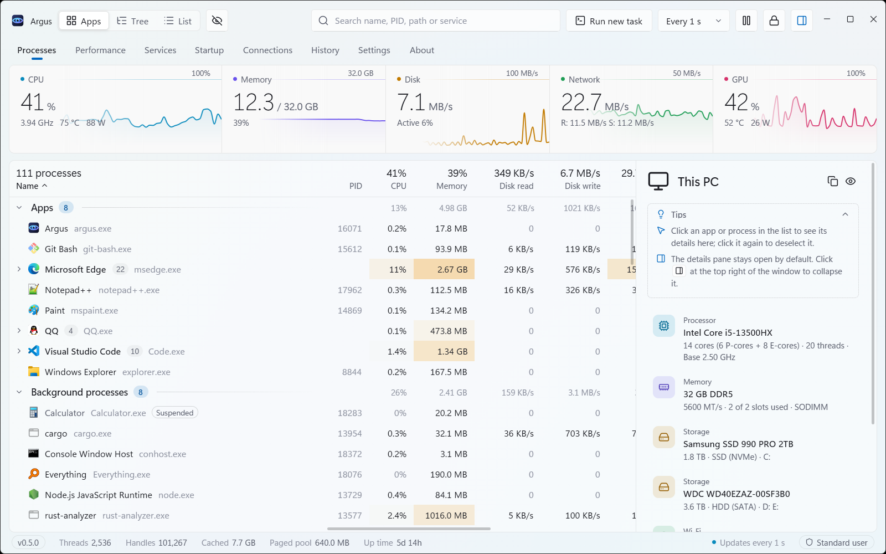

<div align="center">


# GoodGood

**빠르고 현대적이며 정보가 풍부한 Windows 작업 관리자**

**한국어** · [English](README.en.md) · [Español](README.es.md) · [Deutsch](README.de.md) · [日本語](README.ja.md) · [Français](README.fr.md) · [Русский](README.ru.md)

[](https://goodgoodtask.com/)

설치 없이 [공식 웹사이트](https://goodgoodtask.com/)에서 전체 인터랙티브 인터페이스와 안내 투어를 브라우저에서 바로 사용해 볼 수 있습니다

[](https://github.com/acc0mplish/GoodGood/releases)
[](https://github.com/acc0mplish/GoodGood/releases)
[](#-시스템-요구-사항)
[](LICENSE)

[기능](#-기능) · [다운로드](#-다운로드) · [소스에서 빌드](#-소스에서-빌드) · [키보드 바로 가기](#-키보드-바로-가기) · [문서](#-문서)

</div>

<br>

<picture>
  <source media="(prefers-color-scheme: dark)" srcset="docs/images/screenshot-ko-dark.png">
  
</picture>

<br>

GoodGood은 Rust로 Windows 네이티브 API를 직접 조회하며, GPUI Kit 네이티브 구성 요소로 만든 인터페이스와 화면 주사율에 맞춰 매끄럽게 흐르는 곡선을 갖추었습니다. 이름은 좋은 것을 뜻하는 “good”을 두 번 겹친 것입니다.

## ⭐ 별표 기록

GoodGood이 일상 작업에 도움이 된다면 GitHub에서 별표를 남겨 주십시오. 프로젝트를 후원하는 가장 직접적인 방법이며 더 많은 사람이 GoodGood을 발견하는 데 도움이 됩니다.

<a href="https://www.star-history.com/#acc0mplish/GoodGood&Date">
  <picture>
    <source media="(prefers-color-scheme: dark)" srcset="https://api.star-history.com/svg?repos=acc0mplish/GoodGood&type=Date&theme=dark">
    
  </picture>
</a>

## ✨ 기능

<table>
<tr>
<td width="50%" valign="top"><picture><source media="(prefers-color-scheme: dark)" srcset="docs/images/features/processes-ko-dark.svg"></picture><br><b>프로세스</b>: 앱, 프로세스 트리, 목록 보기로 확인하고 검색, 정렬, 트리 전체 끝내기를 지원합니다</td>
<td width="50%" valign="top"><picture><source media="(prefers-color-scheme: dark)" srcset="docs/images/features/performance-ko-dark.svg"></picture><br><b>성능</b>: 코어별 CPU 사용률, 속도, 온도와 전력에 메모리, 디스크, 네트워크, GPU를 함께 표시합니다</td>
</tr>
<tr>
<td width="50%" valign="top"><picture><source media="(prefers-color-scheme: dark)" srcset="docs/images/features/history-ko-dark.svg"></picture><br><b>기록</b>: 7일 곡선의 임의 시점을 클릭하면 그때 가장 사용량이 많았던 프로세스를 볼 수 있습니다</td>
<td width="50%" valign="top"><picture><source media="(prefers-color-scheme: dark)" srcset="docs/images/features/files-ko-dark.svg"></picture><br><b>파일 사용 현황</b>: 파일이나 폴더를 창에 끌어다 놓으면 사용 중인 프로세스를 나열합니다</td>
</tr>
<tr>
<td width="50%" valign="top"><picture><source media="(prefers-color-scheme: dark)" srcset="docs/images/features/rules-ko-dark.svg"></picture><br><b>상황에 맞는 메뉴</b>: 우선 순위를 설정하고 효율성 모드를 켜거나, 시작할 때마다 적용되는 규칙을 추가합니다</td>
<td width="50%" valign="top"><picture><source media="(prefers-color-scheme: dark)" srcset="docs/images/features/ports-ko-dark.svg"></picture><br><b>연결과 포트</b>: 포트로 연결과 해당 프로세스를 찾고 바로 끊을 수 있습니다</td>
</tr>
</table>

<table>
<tr>
<td width="50%" valign="top"><b>서비스와 시작 프로그램</b><br>서비스를 시작하고 중지하며 시작 유형을 바꾸고, 시작 프로그램을 사용하거나 사용 안 함으로 설정합니다</td>
<td width="50%" valign="top"><b>알림 영역</b><br><kbd>Ctrl</kbd>+<kbd>Alt</kbd>+<kbd>Esc</kbd>로 언제든 창을 표시하거나 숨기며, 숨긴 동안 리소스 사용이 매우 적습니다</td>
</tr>
<tr>
<td width="50%" valign="top"><b>작업 관리자 대체</b><br><a href="docs/architecture/task-manager.md">Windows 작업 관리자를 대체</a>해 <kbd>Ctrl</kbd>+<kbd>Shift</kbd>+<kbd>Esc</kbd>로 열 수 있으며, 새 작업을 실행하고 Windows 탐색기를 다시 시작합니다</td>
<td width="50%" valign="top"><b>모양과 언어</b><br>Mica 배경, 시스템 강조 색과 밝게·어둡게 테마를 따르며 7개 인터페이스 언어를 지원합니다</td>
</tr>
<tr>
<td width="50%" valign="top"><b>앱 내 업데이트</b><br>안정판과 베타 채널, 백그라운드 다운로드, 앱에서 보는 릴리스 정보</td>
<td width="50%" valign="top"><b>권한</b><br>표준 사용자도 모든 프로세스를 볼 수 있고, 권한 있는 서비스와 관리자 권한 시작은 선택 사항입니다</td>
</tr>
</table>

<sub>README가 허용하는 공간과 이미지 형식 때문에 위 데모는 예시 프로세스와 데이터로 GoodGood 인터페이스를 단순하게 다시 그린 것입니다. 참고용이며 실제 프로그램이 기준입니다.</sub>

## 📦 다운로드

최신 안정판과 SHA-256 체크섬은 [공식 다운로드 페이지](https://goodgoodtask.com/download/)에서 받을 수 있습니다. 모든 버전은 [GitHub Releases](https://github.com/acc0mplish/GoodGood/releases)에서도 제공됩니다.

| 파일 | 설명 |
|---|---|
| `GoodGood_<version>_x64-setup.exe` | **설치 프로그램(권장).** 모든 사용자를 위해 `Program Files`에 설치하며 설치와 업데이트에 관리자 권한이 필요합니다. 앱 내 업데이트를 지원합니다. |
| `GoodGood_<version>_x64.exe` | **포터블 버전.** 단독 실행 파일로 바로 실행하며 설치 버전과 설정 및 기록을 공유합니다. 자동 업데이트는 지원하지 않습니다. |
| `SHA256SUMS.txt` | 위 릴리스 파일의 SHA-256 체크섬입니다. |

[코드 서명 정책](#코드-서명-정책) · [개인정보 처리방침](PRIVACY.md)

## 💻 시스템 요구 사항

- **운영 체제**: Windows 10 버전 22H2(빌드 19045) 이상, Windows 11 포함(x64 전용)
- **그래픽**: DirectX 11을 지원하는 그래픽 장치와 드라이버

검증된 Windows 버전, 기능 차이와 권한 요구 사항은 [호환 범위](docs/guide/hardware-data.md#시스템-호환-범위)를 참고하십시오.

## 🔧 소스에서 빌드

준비 사항:

- Rust `stable-x86_64-pc-windows-msvc` 도구 체인(1.100.0 이상)
- Node.js 26.x(26.13.1 이상, 24.x LTS는 24.22.3 이상도 지원)와 bun 1.4.4
- Visual Studio Build Tools("Desktop development with C++" 워크로드)

저장소 루트에서 PowerShell로 다음 명령을 실행합니다:

```powershell
.\start.bat           # 개발 모드: Rust와 리소스 변경을 자동으로 다시 빌드하고 재시작하며, 빌드에 실패하면 실행 중인 인스턴스를 유지합니다
.\start.bat build     # 릴리스 빌드: target\release\goodgood.exe를 만듭니다
```

코드 검사, 설치 프로그램 패키징과 캐시 정리는 [개발 가이드](docs/development/README.md)를 참고하십시오.

## 🔑 키보드 바로 가기

| 동작 | 키 |
|---|---|
| 페이지 전환 | <kbd>Ctrl</kbd>+<kbd>1</kbd> … <kbd>Ctrl</kbd>+<kbd>9</kbd> |
| 프로세스 검색 | <kbd>Ctrl</kbd>+<kbd>F</kbd> |
| 새로 고침 일시 중지 | <kbd>Ctrl</kbd>을 누르고 있는 동안 멈추며, 놓으면 다시 시작합니다(프로세스와 성능) |
| 세부 정보 열기 | <kbd>Enter</kbd> |
| 작업 끝내기 | <kbd>Alt</kbd>+<kbd>E</kbd> 또는 <kbd>Delete</kbd>(<kbd>Shift</kbd>+<kbd>Delete</kbd>는 확인을 건너뜁니다) |
| 창 표시 또는 숨기기(전역) | <kbd>Ctrl</kbd>+<kbd>Alt</kbd>+<kbd>Esc</kbd> |

전체 바로 가기 목록은 설정 → 키보드 바로 가기 → 바로 가기 보기에서 확인할 수 있고, 자세한 사용 방법은 [사용 가이드](docs/guide/README.md)에서 다룹니다.

## 📚 문서

문서는 한국어로 작성되며, [온라인 문서](https://goodgoodtask.com/docs/)(안정판과 개발판)도 제공됩니다.

| 문서 | 내용 |
|---|---|
| [사용 가이드](docs/guide/README.md) | 인터페이스와 조작, 알림 영역과 바로 가기, 설정, 하드웨어 데이터의 출처와 한계 |
| [기능 안내](docs/guide/features.md) | 프로세스와 작업 제어, 성능과 하드웨어, 기록, 서비스와 시작 프로그램, 연결과 포트, 파일 사용 항목, 알림 영역과 모니터, 화면 배치, 권한 |
| [개발 가이드](docs/development/README.md) | 환경과 명령, 빌드와 캐시, 성능 기준선과 측정 |
| [아키텍처](docs/architecture/README.md) | 계층과 데이터 흐름, 기술 스택, 모듈의 역할 |
| [디자인](docs/design/README.md) | 디자인 원칙, 곡선 애니메이션, 창 모양과 재질 |
| [알려진 문제](docs/known-issues.md) | 현재 버전의 알려진 제한 |
| [변경 기록](changelog/ko-KR.md) | 릴리스별 세부 변경 사항 |

## 🤝 기여

이슈와 끌어오기 요청을 환영합니다. 보안 취약점은 비공개로 알려 주십시오.

## 🧭 로드맵

완료한 이정표와 전체 계획은 [로드맵](docs/roadmap.md)을 참고하십시오. 진행 중이거나 계획된 작업은 다음과 같습니다:

- [ ] **하드웨어 센서 확장**: 공식 PawnIO 드라이버를 통해 소비자용 하드웨어 센서 범위를 계속 넓힙니다([하드웨어 범위](docs/guide/hardware-data.md) 참고)
- [ ] **키보드 바로 가기 확장**: 왼쪽과 오른쪽 보조 키를 구분하고, 보조 키만으로 이루어진 조합이나 보조 키가 아닌 두 키의 조합을 지원합니다

<a id="코드-서명-정책"></a>

## 🔐 코드 서명 정책

무료 코드 서명은 [SignPath.io](https://about.signpath.io/)가 제공하며 인증서는 [SignPath Foundation](https://signpath.org/)이 제공합니다.

테스트 서명은 연동되어 있으며 정식 릴리스는 현재 Windows Authenticode 서명 없이 배포됩니다. 정식 서명을 활성화하면 이 저장소의 소스를 GitHub Actions로 빌드한 GoodGood 애플리케이션, 작업 관리자 도우미, 제거 프로그램과 설치 프로그램에 적용됩니다. 함께 배포되는 타사 프로그램은 원래 서명을 유지합니다.

- **개인정보 처리방침**: [한국어](PRIVACY.md). 기본으로 켜져 있는 업데이트 확인, 프록시 대체, 필요할 때의 PawnIO 다운로드, 자발적 피드백과 타사 데이터 처리를 다룹니다.

앱 내 업데이트는 별도의 Minisign 릴리스 키로 설치 프로그램과 버전 번호를 검증하며, Windows Authenticode는 실행 파일의 서명자를 확인합니다.

## 🙏 감사의 말

GoodGood은 다음 오픈 소스 프로젝트를 기반으로 만들어졌으며 진심으로 감사드립니다:

| 프로젝트 | 사용 목적 |
|---|---|
| [GPUI Kit](https://gpui-kit.com/) | 네이티브 데스크톱 구성 요소, 창, 표와 곡선 |
| [windows-rs](https://github.com/microsoft/windows-rs) | Windows 네이티브 API의 Rust 바인딩 |
| [Biome](https://biomejs.dev/), [NSIS](https://nsis.sourceforge.io/) | 개발 검사와 Windows 패키징 |
| [serde](https://serde.rs/), [reqwest](https://github.com/seanmonstar/reqwest) 등 Rust 크레이트 | 직렬화, 네트워크와 기반 기능 |
| [PawnIO](https://pawnio.eu/), [PawnIO.Modules](https://github.com/namazso/PawnIO.Modules) | 선택적 커널 센서를 뒷받침하는 서명된 드라이버와 수집 모듈 |
| [ZenStates-Core](https://github.com/irusanov/ZenStates-Core), [LibreHardwareMonitor](https://github.com/LibreHardwareMonitor/LibreHardwareMonitor), [GNR-SMU](https://github.com/Kyworn/gnr-smu) | AMD SMU 표 등 CPU 레지스터 배치 참고 자료 |
| [Intel IGCL](https://github.com/intel/drivers.gpu.control-library), [AMD ADL](https://github.com/GPUOpen-LibrariesAndSDKs/display-library) | GPU 원격 측정 인터페이스 |

모든 타사 구성 요소와 라이선스 고지는 [THIRD-PARTY-NOTICES.txt](THIRD-PARTY-NOTICES.txt)에 정리되어 있습니다.

<!-- supporters:start · node scripts/supporters.mjs -->
<!-- supporters:end -->

## 📄 라이선스

GoodGood은 [Apache License 2.0](LICENSE)으로 배포되는 자유 소프트웨어입니다.

<div align="center">
<br>
<sub>GoodGood · Task manager for Windows · © 2026 GoodGood contributors</sub>
</div>
